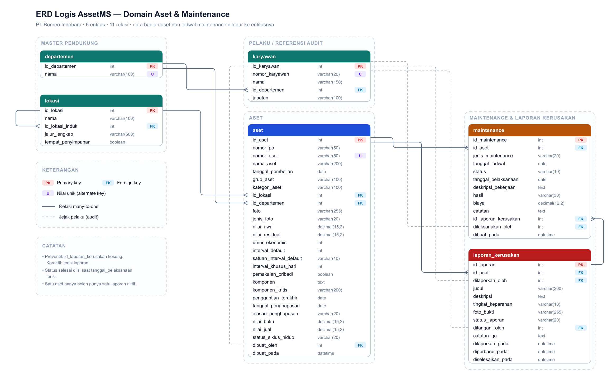

# 4.2 Analisis dan Perancangan Sistem

Pada bagian ini dibahas proses analisis dan perancangan sistem yang mengacu pada tahapan dalam metode *Systems Development Life Cycle* (SDLC) dengan pendekatan model *Waterfall*. Tahapan tersebut digunakan sebagai dasar dalam merancang sistem informasi manajemen aset pada PT Borneo Indobara. Sistem yang dirancang diberi nama **AssetMS (Asset Management System)**, yaitu sistem berbasis *website* yang mengelola siklus hidup aset perusahaan mulai dari perolehan, penempatan, serah terima, pemeliharaan, pelaporan kerusakan, hingga penghapusan aset.

## 4.2.1 Identifikasi Stakeholder

Whitten dan Bentley (2007) menyatakan bahwa *stakeholder* adalah individu yang berkepentingan dengan sistem informasi, baik internal maupun eksternal organisasi, serta mencakup peran teknis maupun non-teknis. Tabel 4.1 memperlihatkan *stakeholder* yang terlibat dalam perancangan sistem informasi manajemen aset pada PT Borneo Indobara.

**Tabel 4.1 Stakeholder Perancangan Sistem**

| Stakeholder | Peran | Berperan dalam |
|---|---|---|
| Kepala Departemen HRGA PT Borneo Indobara | *System Owner* | Menentukan arah pengembangan sistem, menggambarkan kebutuhan fungsional maupun non-fungsional, menetapkan kebijakan pengelolaan aset, dan melakukan uji terima terhadap sistem baru. |
| Staf General Affairs (GA) | *System User* (pengguna utama) | Memberikan gambaran kebutuhan fungsional dan non-fungsional sistem, serta menjalankan proses operasional harian: pendataan aset, pemeliharaan, serah terima, perpindahan, penanganan laporan kerusakan, penerbitan berita acara, dan pengelolaan data master. |
| Staf Finance | *System User* | Memberikan kebutuhan terkait data finansial aset, mengisi nilai perolehan, nilai residual, dan umur ekonomis, serta memantau nilai buku dan penyusutan aset. |
| Karyawan pemegang aset | *System User* | Memberikan gambaran kebutuhan pengguna lapangan, melihat aset yang dipegang, melaporkan kerusakan aset, dan melaporkan perpindahan aset. |
| Kepala Departemen pemilik aset | *System User* (penerima laporan) | Menerima dan menandatangani Berita Acara Kerusakan/Penghapusan, serta meninjau rekomendasi penghapusan aset pada departemennya. Interaksi dilakukan melalui dokumen berita acara yang dicetak sistem. |
| Peneliti | *System Analyst*, *System Designer*, & *System Builder* | Melakukan analisis kebutuhan, merancang sistem, mengimplementasikan rancangan menjadi aplikasi, serta melakukan pengujian sesuai spesifikasi yang telah dirancang. |
| Vendor/penyedia jasa perbaikan | *External Stakeholder* (non-teknis) | Menjadi sumber data pelaksanaan perbaikan aset oleh pihak ketiga. Data vendor dicatat oleh GA ke dalam sistem; vendor tidak memiliki akses langsung ke aplikasi. |

## 4.2.2 Identifikasi Kebutuhan User

Langkah pertama dalam mendesain sistem informasi adalah dengan memetakan kebutuhan sistem yang akan dikembangkan, yang dapat direpresentasikan melalui *user stories*. Identifikasi kebutuhan user dengan *user stories* adalah sebuah proses pada tahap awal perancangan sistem yang bertujuan untuk menangkap keinginan pengguna melalui narasi singkat dan sederhana dari sudut pandang mereka sendiri. Alih-alih menggunakan bahasa teknis yang kaku, metode ini fokus pada penjelasan mengenai siapa penggunanya, fitur apa yang mereka butuhkan, dan apa nilai bisnis atau manfaat yang ingin dicapai. Proses ini dilakukan melalui wawancara dan observasi langsung, serta dilengkapi dengan *acceptance criteria* sebagai tolak ukur untuk memastikan bahwa setiap kebutuhan telah terpenuhi dengan benar sesuai ekspektasi pengguna dan perancang. Tabel 4.2 merupakan *user stories* yang didapatkan oleh perancang.

**Tabel 4.2 User Stories**

| No | Peran | Story | Acceptance Criteria |
|---|---|---|---|
| 1 | Staf GA | Sebagai staf GA, saya ingin mendaftarkan aset baru lengkap dengan nomor aset, nomor PO, tanggal perolehan, kategori, lokasi, dan departemen pemilik agar setiap aset memiliki satu catatan yang menjadi sumber kebenaran. | Sistem menyimpan seluruh atribut wajib aset, menolak nomor aset yang duplikat, menyimpan lebih dari satu foto dengan satu foto utama, dan otomatis membuat jadwal maintenance awal dari interval kategori aset. |
| 2 | Staf GA | Sebagai staf GA, saya ingin mencari dan menyaring daftar aset berdasarkan status, lokasi, kategori, dan kepemilikan agar aset dapat ditemukan dengan cepat. | Daftar aset menampilkan status siklus hidup dan status kesehatan aset, mendukung kombinasi filter dan pencarian kata kunci, serta menggunakan paginasi agar halaman tetap ringan. |
| 3 | Staf GA | Sebagai staf GA, saya ingin mencatat pekerjaan maintenance beserta biayanya agar riwayat perawatan dan akumulasi biaya setiap aset dapat dilacak. | Sistem menyimpan jenis maintenance (preventive, corrective, inspection), hasil, biaya, dan pelaksana; otomatis membuat jadwal berikutnya; serta memulihkan status aset menjadi *active* ketika perbaikan *corrective* dinyatakan selesai. |
| 4 | Staf GA | Sebagai staf GA, saya ingin menerima dan menindaklanjuti laporan kerusakan dari karyawan agar kerusakan tertangani dan status aset selalu akurat. | Laporan baru otomatis mengubah status aset menjadi *maintenance*, melewati jadwal preventive yang belum dikerjakan, dan membuat jadwal *corrective*; GA dapat menerima, menyelesaikan, atau menolak laporan disertai catatan. |
| 5 | Staf GA | Sebagai staf GA, saya ingin menyerahkan aset kepada karyawan atau departemen dan mencatat pengembaliannya agar pemegang aset selalu diketahui. | Satu aset hanya memiliki satu serah terima aktif; pengembalian mencatat kondisi aset; jika aset dikembalikan dalam kondisi rusak, sistem otomatis membuat laporan kerusakan yang sudah diterima GA. |
| 6 | Staf GA | Sebagai staf GA, saya ingin mencatat perpindahan aset antar lokasi dan departemen agar posisi aset selalu benar dan memiliki jejak historis. | Setiap perpindahan baru menutup riwayat perpindahan sebelumnya, menyinkronkan data serah terima dan lokasi aset, serta menyimpan siapa yang mencatat dan kapan perpindahan terjadi. |
| 7 | Staf GA | Sebagai staf GA, saya ingin mengelola data master lokasi, departemen, grup aset, kategori aset, karyawan, dan akun pengguna agar struktur data mengikuti kondisi organisasi. | Lokasi mendukung hierarki site–area–ruang dan penanda tempat penyimpanan; kategori aset menyimpan interval maintenance default dan penanda pemakaian pribadi; akun karyawan terhubung ke peran GA, Finance, atau Karyawan. |
| 8 | Staf GA | Sebagai staf GA, saya ingin mengimpor data aset dan data finansial dari berkas Excel agar pemindahan data awal tidak dilakukan satu per satu. | Sistem menyediakan template Excel yang dapat diunduh, memvalidasi kolom wajib, melewati baris tidak valid disertai alasan, dan menampilkan ringkasan hasil impor. |
| 9 | Staf GA | Sebagai staf GA, saya ingin menerbitkan Berita Acara Kerusakan dan Berita Acara Penghapusan lalu mencetaknya agar keputusan penghapusan aset memiliki dokumen resmi. | Sistem membuat draf berita acara per departemen secara otomatis, memberikan nomor unik per tahun, menyimpan salinan penanda tangan, menghasilkan dokumen siap cetak, dan menghubungkan Berita Acara Penghapusan dengan Berita Acara Kerusakan sebagai rujukan. |
| 10 | Staf GA | Sebagai staf GA, saya ingin melihat ringkasan dan analitik kondisi aset, jadwal maintenance, laporan kerusakan, biaya, serta kandidat penghapusan agar dapat memprioritaskan tindakan. | Dashboard menampilkan angka status aset, jadwal terlambat dan mendekati jatuh tempo, laporan kerusakan aktif, grafik tren maintenance dan biaya, daftar aset critical, serta kandidat *write off*. |
| 11 | Staf GA | Sebagai staf GA, saya ingin mengelola akun karyawan dan mengatur perannya agar setiap pengguna hanya mengakses fitur yang sesuai. | GA dapat membuat akun yang terhubung ke data karyawan, menetapkan peran, mengganti kata sandi, dan menonaktifkan akun tanpa menghapus riwayat aset. |
| 12 | Staf Finance | Sebagai staf Finance, saya ingin mengisi nilai perolehan, nilai residual, dan umur ekonomis aset agar nilai buku dan penyusutan aset dapat dihitung. | Sistem menghitung penyusutan dengan metode garis lurus, menjaga nilai buku tidak lebih rendah dari nilai residual, dan menghentikan penyusutan pada tanggal *write off*. |
| 13 | Staf Finance | Sebagai staf Finance, saya ingin melihat rekap nilai aset per grup, departemen, dan tahun perolehan serta daftar aset yang belum dinilai agar kewajaran nilai aset dapat ditinjau. | Dashboard nilai aset menampilkan total perolehan, akumulasi penyusutan, nilai buku, sebaran per grup dan departemen, serta jumlah aset belum dinilai. |
| 14 | Staf Finance | Sebagai staf Finance, saya ingin melihat aset yang umur ekonomisnya habis atau hampir habis agar penggantian aset dapat direncanakan. | Sistem menampilkan daftar aset beserta sisa umur ekonomis, nilai buku, dan rekomendasi tindak lanjut. |
| 15 | Karyawan | Sebagai karyawan, saya ingin melihat aset yang saya pegang dan aset bersama departemen saya agar tanggung jawab pemakaian aset menjadi jelas. | Dashboard karyawan menampilkan aset pribadi dan aset departemen yang sedang aktif, lengkap dengan status dan lokasinya. |
| 16 | Karyawan | Sebagai karyawan, saya ingin melaporkan kerusakan aset dengan foto, tingkat keparahan, dan deskripsi agar GA dapat menindaklanjuti dengan cepat. | Karyawan dapat memilih aset mana pun yang tidak berstatus *write off*, mengunggah foto bukti, dan laporan masuk berstatus *pending*; sistem mencegah adanya dua laporan aktif untuk aset yang sama. |
| 17 | Karyawan | Sebagai karyawan, saya ingin memantau status laporan kerusakan yang saya kirim agar saya mengetahui perkembangan penanganannya. | Daftar dan detail laporan menampilkan status terkini, riwayat waktu, serta catatan dari GA. |
| 18 | Karyawan | Sebagai karyawan, saya ingin melaporkan perpindahan aset yang saya bawa agar posisi aset tercatat tanpa harus menunggu GA. | Perpindahan biasa langsung tercatat sebagai riwayat; perpindahan yang memindahkan kepemilikan departemen atau memindahkan *site* masuk status menunggu persetujuan GA; satu aset hanya boleh memiliki satu laporan pindah yang menunggu persetujuan. |
| 19 | Kepala Departemen | Sebagai kepala departemen, saya ingin menerima Berita Acara dan rekomendasi penghapusan aset departemen saya agar keputusan penghapusan dapat ditandatangani. | Dokumen berita acara memuat daftar aset, uraian kerusakan, rekomendasi, nilai perolehan, nilai buku, dan kolom tanda tangan pihak yang berwenang. |

## 4.2.3 Identifikasi Kebutuhan Sistem

Satzinger, Jackson, dan Burd (2012) mendefinisikan kebutuhan sistem (*system requirements*) sebagai seluruh rangkaian aktivitas yang wajib didukung oleh sistem, termasuk berbagai batasan yang harus dipenuhi oleh sistem baru tersebut. Secara garis besar, kebutuhan ini diklasifikasikan ke dalam dua kelompok utama, yaitu kebutuhan fungsional (*functional requirements*) dan kebutuhan non-fungsional (*nonfunctional requirements*). Tabel 4.3 merupakan hasil identifikasi kebutuhan sistem menggunakan *framework* FURPS.

**Tabel 4.3 Identifikasi Kebutuhan Sistem Menggunakan Framework FURPS**

| No | Aspek | Deskripsi |
|---|---|---|
| 1 | *Functionality* | 1. Sistem mampu mengelola autentikasi dan otorisasi pengguna berdasarkan peran GA, Finance, dan Karyawan. 2. Sistem mampu mengelola data master: departemen, lokasi hierarkis, grup aset, kategori aset, karyawan, dan akun pengguna. 3. Sistem mampu mencatat, mengubah, menampilkan, dan menghapus data aset beserta foto dan status siklus hidupnya. 4. Sistem mampu menyimpan data finansial aset, menghitung penyusutan garis lurus, dan menampilkan nilai buku. 5. Sistem mampu membuat jadwal maintenance otomatis dari interval kategori atau interval khusus per aset, menandai jadwal terlambat, dan mencatat pelaksanaan maintenance. 6. Sistem mampu mengelola komponen aset dan riwayat penggantian komponen. 7. Sistem mampu memproses laporan kerusakan mulai dari pelaporan karyawan, penerimaan GA, perbaikan, hingga penyelesaian atau penolakan. 8. Sistem mampu mencatat serah terima aset kepada karyawan atau departemen, pengembalian, dan riwayat perpindahan aset. 9. Sistem mampu membuat draf, menerbitkan, mencetak, dan menandai Berita Acara Kerusakan serta Berita Acara Penghapusan. 10. Sistem mampu memproses *write off* aset beserta pembatalannya dan menyimpan nilai aset pada saat penghapusan. 11. Sistem mampu mengimpor data aset dan data finansial dari berkas Excel sesuai template. 12. Sistem mampu menyajikan dashboard ringkasan, analitik nilai aset, kinerja maintenance, tinjauan umur ekonomis, dan pelacakan lokasi. 13. Sistem mampu melakukan pencarian aset dan menampilkan notifikasi tindakan yang perlu ditindaklanjuti. |
| 2 | *Usability* | 1. Antarmuka pengguna mudah dipahami dan menggunakan bahasa Indonesia. 2. Setiap peran memiliki beranda dan menu yang disesuaikan sehingga tidak dibebani fitur yang bukan haknya. 3. Status aset, jadwal, dan laporan kerusakan ditampilkan dengan warna dan piktogram yang konsisten sehingga mudah dipindai. 4. Sistem nyaman digunakan pada desktop maupun ponsel karena sebagian pengguna bekerja di lapangan. 5. Sistem memberikan umpan balik yang jelas berupa pesan berhasil, gagal, atau peringatan pada setiap aksi. |
| 3 | *Reliability* | 1. Sistem tidak mengalami kehilangan data ketika beberapa pengguna melakukan input secara bersamaan. 2. Proses yang melibatkan beberapa tabel dijalankan dalam satu transaksi, misalnya pelaporan kerusakan, perpindahan aset, dan *write off*. 3. Sistem mencegah data ganda melalui aturan keunikan, seperti satu serah terima aktif per aset, satu riwayat perpindahan aktif per aset, satu laporan kerusakan aktif per aset, dan nomor berita acara yang unik. 4. Sistem menyediakan informasi yang benar dan telah divalidasi sebelum disimpan. 5. Status jadwal yang terlambat diperbarui secara otomatis setiap hari. |
| 4 | *Performance* | 1. Sistem tetap responsif ketika menampilkan daftar aset, riwayat maintenance, dan laporan dalam jumlah besar. 2. Halaman daftar menggunakan paginasi dan query agregasi agar waktu muat tetap wajar. 3. Sistem mampu melakukan perpindahan halaman dalam waktu kurang dari 5 detik pada kondisi jaringan normal. 4. Sistem mampu menangani data uji berupa ratusan aset dan ribuan catatan maintenance serta tetap dapat berkembang seiring pertambahan data. |
| 5 | *Security* | 1. Sistem memiliki fitur login untuk proses autentikasi pengguna menggunakan *username* dan *password*. 2. Sistem memiliki fitur otorisasi berbasis peran agar pengguna hanya dapat mengakses fitur dan data tertentu. 3. Sistem memvalidasi setiap masukan dan menggunakan proteksi CSRF pada formulir. 4. Kata sandi disimpan dalam bentuk *hash* dan dapat diubah oleh GA. 5. Akun yang tidak memiliki peran atau dinonaktifkan tidak dapat mengakses sistem. |
| 6 | *Supportability* | 1. Sistem disusun secara modular berdasarkan domain fungsi sehingga mudah dipelihara dan dikembangkan. 2. Perubahan struktur basis data dikelola melalui migrasi. 3. Sistem memiliki pengujian otomatis untuk alur bisnis utama. 4. Tersedia data awal (*fixture*/*seed*) dan template Excel untuk memudahkan pemasangan dan migrasi data. 5. Kode sumber disimpan dalam repositori Git agar perubahan dapat dilacak. |

## 4.2.4 System Requirement Checklist (SRC)

Secara sederhana, *System Requirement Checklist* (SRC) digunakan untuk memastikan bahwa sistem baru yang akan dibangun benar-benar memiliki semua fitur yang dibutuhkan oleh organisasi (Rosenblatt, 2014). Komponen SRC mencakup *input*, *output*, *process*, *performance*, dan *control*. Tabel 4.4 menunjukkan daftar kebutuhan yang harus dipenuhi dari masing-masing komponen SRC.

**Tabel 4.4 System Requirement Checklist**

| Komponen | No | Kebutuhan |
|---|---|---|
| *Input* | 1 | Data pengguna (akun, kata sandi, dan peran) |
| | 2 | Data karyawan (nomor karyawan, nama, departemen, jabatan) |
| | 3 | Data departemen |
| | 4 | Data lokasi (site, area, ruang, dan tempat penyimpanan) |
| | 5 | Data grup aset |
| | 6 | Data kategori aset (interval maintenance default dan penanda pemakaian pribadi) |
| | 7 | Data aset (nomor aset, nomor PO, nama, tanggal pembelian, kategori, lokasi, departemen pemilik, status) |
| | 8 | Data foto aset (foto unit, lokasi, kerusakan, dan foto utama) |
| | 9 | Data finansial aset (nilai perolehan, nilai residual, umur ekonomis) |
| | 10 | Data komponen aset (nomor part, nama, jumlah, harga estimasi, penanda komponen kritis) |
| | 11 | Data penggantian komponen (tanggal, alasan, biaya, nomor part lama) |
| | 12 | Data konfigurasi interval maintenance khusus per aset |
| | 13 | Data jadwal maintenance (tanggal, status, keterkaitan dengan laporan kerusakan) |
| | 14 | Data catatan maintenance (jenis, tanggal, deskripsi, hasil, biaya, pelaksana) |
| | 15 | Data serah terima aset (penerima, tanggal, kondisi pengembalian) |
| | 16 | Data perpindahan aset (pemegang, departemen, lokasi, waktu masuk dan keluar) |
| | 17 | Data laporan perpindahan dari karyawan (posisi asal, tujuan, alasan, status persetujuan) |
| | 18 | Data laporan kerusakan (aset, pelapor, judul, deskripsi, tingkat keparahan, foto bukti) |
| | 19 | Data berita acara (jenis, departemen, nomor, tanggal, isi, status, rujukan) |
| | 20 | Data item berita acara (aset, sumber temuan, uraian kerusakan, rekomendasi) |
| | 21 | Data foto berita acara |
| | 22 | Data penanda tangan berita acara (peran, nama, jabatan) |
| | 23 | Data penghapusan aset (tanggal, alasan, keterangan, nilai perolehan, nilai buku, nilai jual) |
| *Output* | 1 | Informasi ringkasan kondisi aset, jadwal maintenance, laporan kerusakan, dan biaya |
| | 2 | Informasi daftar aset, kartu aset, foto, dan riwayat aset |
| | 3 | Informasi jadwal maintenance yang akan datang dan yang terlambat |
| | 4 | Informasi laporan kerusakan beserta status tindak lanjutnya |
| | 5 | Informasi pemegang aset dan riwayat perpindahan aset |
| | 6 | Informasi nilai perolehan, penyusutan, nilai buku, dan nilai aset per grup/departemen |
| | 7 | Informasi kinerja maintenance (kepatuhan jadwal, biaya, waktu penyelesaian laporan) |
| | 8 | Informasi tinjauan umur ekonomis dan rekomendasi penggantian/penghapusan |
| | 9 | Dokumen Berita Acara Kerusakan dan Berita Acara Penghapusan siap cetak |
| | 10 | Rekapitulasi aset per lokasi, departemen, kategori, dan status |
| | 11 | Template Excel dan ringkasan hasil impor data |
| | 12 | Notifikasi tindakan yang perlu ditindaklanjuti |
| *Process* | 1 | Mengelola autentikasi dan otorisasi pengguna |
| | 2 | Mengelola data master (departemen, lokasi, grup, kategori, karyawan, akun) |
| | 3 | Mengelola data aset dan foto aset |
| | 4 | Mengelola data finansial dan menghitung penyusutan serta nilai buku |
| | 5 | Membuat dan memperbarui jadwal maintenance secara otomatis |
| | 6 | Mencatat pelaksanaan maintenance dan penggantian komponen |
| | 7 | Memproses laporan kerusakan dari karyawan hingga selesai atau ditolak |
| | 8 | Mencatat serah terima dan pengembalian aset |
| | 9 | Mencatat perpindahan aset dan menyetujui laporan perpindahan yang krusial |
| | 10 | Membuat draf, menerbitkan, mencetak, dan menandai berita acara |
| | 11 | Memproses *write off* aset dan pembatalannya |
| | 12 | Mengimpor data aset dan finansial dari Excel |
| | 13 | Menghitung status kesehatan aset dan tinjauan umur ekonomis |
| | 14 | Menyusun dashboard dan analitik |
| | 15 | Mencari aset dan menampilkan notifikasi |
| *Performance* | 1 | Sistem dapat digunakan oleh pengguna yang terautentikasi dengan hak akses berbeda: GA memiliki akses penuh terhadap pengelolaan aset dan master data, Finance memiliki akses pada data finansial dan dashboard terkait, sedangkan Karyawan hanya dapat melihat aset yang dipegang, aset departemen, serta membuat laporan. |
| | 2 | Sistem dapat diakses melalui desktop maupun ponsel dengan tampilan yang menyesuaikan ukuran layar. |
| | 3 | Halaman utama dan daftar data dapat dimuat dalam waktu kurang dari 5 detik pada kondisi jaringan normal. |
| | 4 | Sistem mampu menyimpan dan menampilkan data aset, riwayat maintenance, dan laporan dalam jumlah besar dengan bantuan paginasi dan query yang dioptimalkan. |
| | 5 | Sistem diimplementasikan pada *server* agar dapat diakses beberapa pengguna secara bersamaan dan lebih mudah dipelihara. |
| *Control* | 1 | *Authentication*: diperlukan untuk membedakan peran pada masing-masing pengguna yang berinteraksi dengan sistem. |
| | 2 | *Authorization*: diperlukan untuk membatasi fitur dan data yang dapat diakses oleh masing-masing peran. |
| | 3 | Validasi masukan: kolom wajib, format tanggal dan angka, keunikan nomor aset, serta pencegahan laporan ganda. |
| | 4 | Integritas transaksi: proses yang melibatkan beberapa tabel dijalankan secara atomik dan dilengkapi batasan pada basis data. |
| | 5 | Jejak aktivitas: sistem mencatat pengguna dan waktu pada transaksi penting, seperti pembuatan aset, pencatatan maintenance, pelaporan kerusakan, perpindahan, dan penerbitan berita acara. |
| | 6 | Konfirmasi tindakan destruktif: penghapusan data, *write off*, dan pembatalan *write off* memerlukan konfirmasi. |
| | 7 | Keamanan sesi: proteksi CSRF, kata sandi ter-*hash*, dan proses keluar dari sistem. |

## 4.2.5 Penetapan Fitur

Seluruh fitur yang dirancang dan diimplementasikan dalam sistem informasi ini disusun berdasarkan hasil analisis kebutuhan yang telah dilakukan sebelumnya. Adapun rincian fitur tersebut adalah sebagai berikut.

1. **Autentikasi dan Otorisasi Pengguna**
   Pengguna mengakses sistem menggunakan *username* dan *password* unik. Hak untuk menggunakan fitur dan melihat informasi disesuaikan secara otomatis berdasarkan tingkat kewenangan masing-masing peran, yaitu GA, Finance, dan Karyawan.

2. **Pengelolaan Data Master**
   Pengguna GA dapat mengelola data departemen, lokasi hierarkis (site–area–ruang) termasuk penanda tempat penyimpanan, grup aset, kategori aset beserta interval maintenance default dan penanda pemakaian pribadi, data karyawan, serta akun pengguna dan perannya.

3. **Pengelolaan Data Aset dan Foto**
   Pengguna GA dapat mencatat dan memperbarui atribut aset, seperti nomor aset, nomor PO, nama aset, tanggal pembelian, kategori, lokasi, departemen pemilik, dan status siklus hidup (*active*, *maintenance*, *write off*). Setiap aset dapat memiliki beberapa foto dengan satu foto utama, serta dilengkapi tampilan kartu aset dan riwayat.

4. **Pengelolaan Data Finansial dan Penyusutan**
   Pengguna Finance dapat mencatat nilai perolehan, nilai residual, dan umur ekonomis aset. Sistem menghitung penyusutan tahunan dengan metode garis lurus, menampilkan nilai buku, dan menyajikan rekap nilai aset per grup, departemen, dan tahun perolehan.

5. **Penjadwalan dan Pencatatan Maintenance**
   Sistem membuat jadwal maintenance awal berdasarkan interval kategori aset atau interval khusus per aset. Jadwal yang telah lewat ditandai terlambat secara otomatis. GA dapat mencatat pelaksanaan maintenance preventive, corrective, dan inspection beserta biaya dan hasilnya; sistem kemudian membuat jadwal berikutnya dan memperbarui status aset apabila perbaikan selesai.

6. **Pengelolaan Komponen Aset**
   GA dapat mencatat komponen penyusun aset, menandai komponen kritis, serta mencatat riwayat penggantian komponen beserta biaya dan alasannya.

7. **Pelaporan Kerusakan oleh Karyawan**
   Karyawan dapat melaporkan kerusakan aset mana pun yang masih aktif dengan mengisi judul, deskripsi, tingkat keparahan, dan foto bukti. Sistem mencegah laporan ganda untuk aset yang sama dan menampilkan riwayat serta status laporan yang pernah dibuat.

8. **Penanganan Laporan Kerusakan oleh GA**
   Laporan kerusakan yang masuk otomatis mengubah status aset menjadi *maintenance*, melewati jadwal preventive yang belum dikerjakan, dan membuat jadwal *corrective*. GA dapat menerima laporan, menyelesaikannya dengan menautkan catatan maintenance, atau menolaknya disertai catatan.

9. **Serah Terima dan Pengembalian Aset**
   GA dapat menyerahkan aset kepada karyawan untuk pemakaian pribadi atau kepada departemen untuk pemakaian bersama. Pengembalian aset mencatat kondisi aset; kondisi rusak otomatis membuat laporan kerusakan. Setiap aset hanya memiliki satu serah terima aktif pada satu waktu.

10. **Pencatatan Perpindahan dan Persetujuan Laporan Pindah**
    Setiap perpindahan aset dicatat sebagai riwayat yang menyimpan pemegang, departemen, lokasi, waktu masuk, dan waktu keluar. Karyawan dapat melaporkan perpindahan secara mandiri; perpindahan yang memindahkan kepemilikan departemen atau memindahkan *site* menunggu persetujuan GA sebelum masuk ke riwayat resmi.

11. **Berita Acara Kerusakan dan Penghapusan**
    Temuan kerusakan dari laporan karyawan, inspeksi, atau maintenance otomatis masuk ke draf Berita Acara Kerusakan per departemen. GA dapat menambah item, melampirkan foto, menerbitkan nomor, mencetak dokumen, dan menandai berita acara telah ditandatangani. Berita Acara Penghapusan diterbitkan dengan merujuk nomor Berita Acara Kerusakan.

12. **Penghapusan Aset (*Write Off*) dan Pembatalannya**
    GA dapat menghapus aset dari daftar aktif dengan menyimpan tanggal, alasan, keterangan, nilai perolehan, nilai buku, dan nilai jual pada saat penghapusan. Sistem menutup jadwal, laporan kerusakan, dan serah terima yang masih berjalan, serta menyediakan fitur pembatalan apabila terjadi kekeliruan.

13. **Import Data Excel**
    GA dapat mengimpor data aset dan data finansial dari berkas Excel menggunakan template yang disediakan sistem. Proses impor memvalidasi kolom wajib, mencocokkan data master, melewati baris tidak valid disertai alasan, dan menampilkan ringkasan hasil.

14. **Dashboard, Analitik, dan Pelacakan**
    Sistem menyediakan ringkasan kondisi aset, grafik tren maintenance dan biaya, dashboard nilai aset, dashboard kinerja maintenance, tinjauan umur ekonomis, serta pelacakan aset berdasarkan hierarki lokasi. Setiap peran memperoleh beranda yang sesuai dengan kebutuhannya.

15. **Pencarian Cepat dan Notifikasi**
    Sistem menyediakan pencarian aset lintas halaman dan notifikasi tindakan yang perlu ditindaklanjuti, seperti jadwal terlambat, laporan kerusakan baru, laporan pindah yang menunggu persetujuan, aset belum memiliki lokasi, dan berita acara yang menunggu tanda tangan.

16. **Pengelolaan Akun Karyawan**
    GA dapat membuat akun karyawan, menetapkan peran, mengganti kata sandi, dan menonaktifkan akun. Penonaktifan akun tidak menghapus riwayat aset yang pernah dipegang karyawan tersebut.

## 4.2.6 Penetapan Deliverables

*Deliverables* merupakan hasil atau keluaran dari proses perancangan sistem yang nantinya akan diberikan kepada *user*. *Deliverables* dari penelitian ini adalah sistem informasi manajemen aset berbasis *website* yang dijalankan pada *server* pengembangan sehingga dapat diakses oleh beberapa pengguna melalui jaringan. Rincian *deliverables* ditunjukkan pada Tabel 4.5.

**Tabel 4.5 Deliverables Penelitian**

| No | Deliverable | Deskripsi | Penerima |
|---|---|---|---|
| 1 | Dokumen analisis dan perancangan sistem | Dokumen yang memuat identifikasi stakeholder, kebutuhan user, kebutuhan sistem, SRC, penetapan fitur, *entities discovery*, *context data model*, *use case*, dan rancangan antarmuka. | System Owner dan pembimbing |
| 2 | Aplikasi web AssetMS | Aplikasi berbasis Django 5.1 dan SQLite yang mencakup seluruh fitur pada subbab 4.2.5. | System Owner dan System User |
| 3 | Basis data dan skrip migrasi | Struktur basis data beserta migrasi, data master awal, dan data uji yang diperlukan untuk menjalankan aplikasi. | System Owner |
| 4 | Template import Excel | Template impor data aset dan data finansial beserta panduan kolom dan contoh pengisian. | Staf GA dan Finance |
| 5 | Template Berita Acara | Format Berita Acara Kerusakan dan Berita Acara Penghapusan yang dihasilkan sistem dan siap dicetak untuk ditandatangani. | Staf GA dan Kepala Departemen |
| 6 | Kode sumber | Kode sumber aplikasi yang tersimpan dalam repositori Git agar dapat dipelihara dan dikembangkan. | System Owner |
| 7 | Dokumentasi teknis | Penjelasan struktur modul, cara menjalankan aplikasi, konfigurasi, dan pengujian. | System Owner dan pengembang |
| 8 | Buku panduan pengguna | Panduan penggunaan aplikasi untuk peran GA, Finance, dan Karyawan. | System User |
| 9 | Laporan skripsi | Laporan tertulis hasil analisis, perancangan, implementasi, dan pengujian sistem. | Institusi pendidikan |

## 4.2.7 Desain Sistem

Tahapan desain sistem dapat diuraikan ke dalam beberapa proses yang terdiri atas *data modelling*, analisis *use case*, *process modelling*, dan perancangan *user interface*. Pada bagian ini pembahasan difokuskan pada *data modelling*, khususnya *entities discovery*, *context data model*, dan *key-based data model*.

*Data modelling* merupakan teknik untuk mengatur, mengelola, dan mendokumentasikan data sistem melalui pemodelan entitas beserta hubungan antar entitas dalam basis data. Untuk memodelkan data, digunakan ERD (*Entity Relationship Diagram*) untuk pemodelan entitas serta atributnya, sedangkan untuk proses pembuatan model data menggunakan paradigma *logical data model*.

### a. *Entities Discovery*

*Entities discovery* menjadi tahap awal karena memberikan gambaran terkait entitas apa saja yang ingin disimpan dalam *database*. Untuk menentukan entitas, dapat dilakukan dengan cara wawancara dengan *system owner* dan *system user* terkait entitas apa yang ingin disimpan, mempelajari laporan dari proses bisnis, serta mempelajari interaksi antara *system user* dan *system owner*. Pada penelitian ini, penentuan entitas juga dilakukan dengan menelaah dokumen yang digunakan organisasi, yaitu Berita Acara Kerusakan, Berita Acara Penghapusan, template import Excel, laporan maintenance, dan daftar aset. Tabel 4.6 menunjukkan *entities discovery* dari sistem manajemen aset.

**Tabel 4.6 Entities Discovery**

| No | Domain | Entitas | Deskripsi |
|---|---|---|---|
| 1 | Organisasi | Departemen | Unit organisasi pemilik aset. |
| 2 | Organisasi | Karyawan | Pegawai yang menjadi pendaftar aset, pelaksana maintenance, pelapor, dan penangan kerusakan. |
| 3 | Lokasi | Lokasi | Struktur lokasi hierarkis (site, area, ruang) beserta penanda tempat penyimpanan aset. |
| 4 | Aset | Aset | Data pokok aset beserta klasifikasi (grup dan kategori), foto utama, nilai finansial, daftar komponen, interval maintenance, dan penanda penghapusan. |
| 5 | Maintenance | Maintenance | Pekerjaan perawatan aset yang memuat rencana (jadwal) sekaligus realisasi pelaksanaannya. |
| 6 | Kerusakan | Laporan Kerusakan | Laporan kerusakan aset dari karyawan beserta tingkat keparahan dan status penanganannya. |

Model data pada penelitian ini disusun ringkas dengan melebur entitas yang masih menjadi bagian dari satu aset ke dalam entitas Aset. Grup Aset menjadi atribut `grup_aset` dan Kategori Aset menjadi atribut `kategori_aset` beserta `interval_default`, `satuan_interval_default`, dan `pemakaian_pribadi`; Foto Aset menjadi atribut `foto` dan `jenis_foto`; Data Finansial Aset menjadi atribut `nilai_awal`, `nilai_residual`, dan `umur_ekonomis`; Komponen Aset disimpan sebagai daftar komponen pada atribut `komponen` dan ditandai melalui `komponen_kritis`; Penggantian Komponen diringkas menjadi `penggantian_terakhir`, sedangkan riwayat penggantiannya tetap tercatat sebagai pekerjaan maintenance dengan hasil `replaced_component`; Penghapusan Aset menjadi atribut `tanggal_penghapusan`, `alasan_penghapusan`, `nilai_buku`, dan `nilai_jual`; serta Konfigurasi Maintenance menjadi atribut `interval_khusus_hari`. Peleburan ini tidak menimbulkan redundansi karena nilai atribut tersebut melekat pada satu baris aset dan tidak bergantung pada entitas lain.

Entitas Maintenance menggabungkan jadwal dan realisasi pekerjaan dalam satu baris. Kolom `tanggal_jadwal` dan `status` merepresentasikan rencana, sedangkan `tanggal_pelaksanaan`, `hasil`, dan `biaya` merepresentasikan realisasinya. Dengan penggabungan ini, pekerjaan yang belum terlaksana tetap tersimpan sebagai baris berstatus `upcoming` dengan `tanggal_pelaksanaan` kosong, sehingga tidak diperlukan dua tabel terpisah untuk jadwal dan catatan.

Sejalan dengan itu, entitas akun dan peran pengguna tidak dimodelkan karena termasuk kebutuhan autentikasi, bukan data bisnis aset. Entitas perpindahan aset dan berita acara juga dikeluarkan dari ERD inti agar diagram tetap terbaca, dan pada pembahasan selanjutnya diperlakukan sebagai modul tersendiri di luar lingkup model data aset dan maintenance.

### b. *Context Data Model*

Tahapan kedua adalah *context data model*, berisi entitas yang sebelumnya telah didefinisikan beserta hubungan antar entitasnya, tetapi masih belum ada atribut pada tahap ini (Whitten & Bentley, 2007). Tabel 4.7 merupakan *context data model* dari sistem manajemen aset.

**Tabel 4.7 Context Data Model**

| No | Entitas 1 | Relasi | Entitas 2 | Kardinalitas |
|---|---|---|---|---|
| 1 | Departemen | Memiliki | Karyawan | 1 : N |
| 2 | Lokasi | Membawahi lokasi lain | Lokasi | 1 : N (relasi diri) |
| 3 | Lokasi | Menempatkan | Aset | 1 : N |
| 4 | Departemen | Memiliki aset | Aset | 1 : N |
| 5 | Karyawan | Mendaftarkan | Aset | 1 : N |
| 6 | Aset | Dijadwalkan dan dirawat melalui | Maintenance | 1 : N |
| 7 | Aset | Mengalami | Laporan Kerusakan | 1 : N |
| 8 | Laporan Kerusakan | Menghasilkan | Maintenance | 1 : N |
| 9 | Karyawan | Melaksanakan | Maintenance | 1 : N |
| 10 | Karyawan | Melaporkan | Laporan Kerusakan | 1 : N |
| 11 | Karyawan | Menangani | Laporan Kerusakan | 1 : N |

Seluruh hubungan pada Tabel 4.7 berjenis *one-to-many*. Tidak ada lagi hubungan *one-to-one* karena entitas pendukung yang sebelumnya berelasi satu-satu dengan Aset telah dilebur menjadi atribut, dan jadwal serta realisasi maintenance telah digabung ke dalam satu entitas. Klasifikasi aset tidak lagi membentuk entitas tersendiri sehingga hubungan Grup Aset–Kategori Aset dan Kategori Aset–Aset tidak diperlukan. Hubungan Karyawan ke Aset, Maintenance, dan Laporan Kerusakan merupakan jejak pelaku yang direpresentasikan melalui kolom `dibuat_oleh`, `dilaksanakan_oleh`, `dilaporkan_oleh`, dan `ditangani_oleh`; pada ERD hubungan ini digambarkan dengan garis putus-putus agar tidak mengaburkan hubungan antarentitas utama.

### c. *Key-based Data Model*

Tahapan selanjutnya adalah model data yang mencakup *primary key* dan *alternate key* (atribut selain *primary key*), serta memperjelas hubungan kardinalitas yang tepat dengan menyelesaikan *non-specific relationship* (*many-to-many relationship*). Tabel 4.8 menunjukkan kandidat kunci untuk entitas utama yang akan digunakan pada tahap *key-based data model*.

**Tabel 4.8 Kandidat Key-based Data Model**

| Entitas | Primary Key | Alternate Key | Keterangan |
|---|---|---|---|
| Departemen | ID Departemen | Nama Departemen | Nama departemen unik. |
| Karyawan | ID Karyawan | Nomor Karyawan | Nomor karyawan unik dan digunakan pada dokumen organisasi. |
| Lokasi | ID Lokasi | Kombinasi Nama dan Lokasi Induk | Nama lokasi unik dalam satu induk. |
| Aset | ID Aset | Nomor Aset | Nomor aset unik dan menjadi identitas utama aset di lapangan. |
| Maintenance | ID Maintenance | — | Satu baris mewakili satu pekerjaan; realisasinya ditandai status `done` dan terisinya `tanggal_pelaksanaan`. |
| Laporan Kerusakan | ID Laporan | — | Hanya satu laporan aktif per aset. |

**Gambar 4.1 ERD Logis AssetMS Domain Aset dan Maintenance**

Hasil penggabungan tersebut digambarkan pada Gambar 4.1 dalam bentuk ERD logis dengan 6 entitas dan 11 relasi. Setiap entitas ditampilkan lengkap dengan atribut, penanda *primary key* (PK), *foreign key* (FK), dan atribut unik (U), sedangkan kardinalitas ditunjukkan melalui notasi kaki gagak. Pada implementasi basis data, atribut hasil peleburan tetap disimpan pada tabel terpisah, yaitu tabel referensi grup dan kategori aset, tabel data finansial dan penghapusan yang berelasi satu-satu dengan tabel aset, serta tabel komponen dan jadwal maintenance, agar perubahan dan riwayatnya dapat diaudit tanpa menimpa data aset; dengan demikian model logis pada Gambar 4.1 tetap konsisten dengan struktur fisik basis data.

Dengan *entities discovery* dan *context data model* di atas, seluruh kebutuhan data pada subbab sebelumnya dapat dipetakan ke dalam entitas yang saling terhubung. Tahap berikutnya dalam perancangan adalah menyusun *use case*, *process modelling*, dan rancangan antarmuka, kemudian mengimplementasikan model data tersebut ke dalam basis data relasional.
